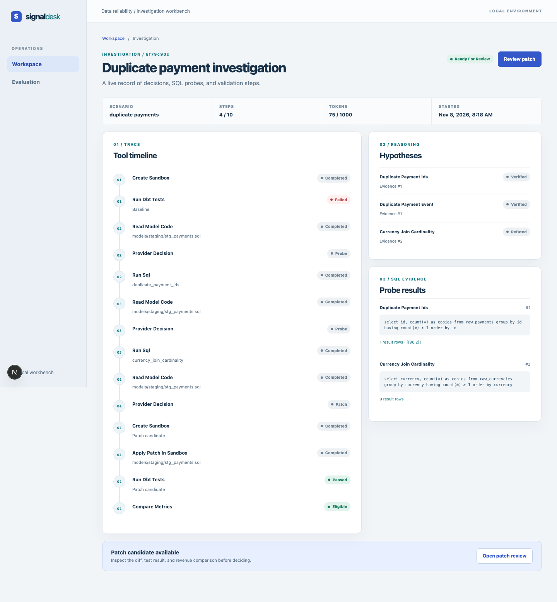
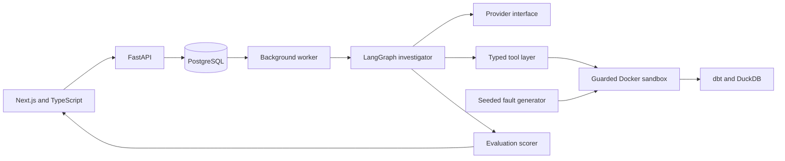

# AI Data Reliability Engineer

A local workbench for investigating seeded dbt revenue incidents with an evidence-gated agent, sandboxed tools, and human review.

   



Wrong numbers in analytics pipelines can reach real decisions. An agent investigating them needs constraints, verification, and measurement before its conclusions are trusted.

## Contents

- [Highlights](#highlights)
- [Intended uses](#intended-uses)
- [By the numbers](#by-the-numbers)
- [Architecture](#architecture)
- [Tech stack](#tech-stack)
- [Quickstart](#quickstart)
- [How an investigation works](#how-an-investigation-works)
- [Development approach](#development-approach)
- [Engineering quality](#engineering-quality)
- [Evaluation](#evaluation)
- [Repository tour](#repository-tour)
- [Limitations and future work](#limitations-and-future-work)
- [License and credit](#license-and-credit)

## Highlights

- A single investigator uses typed tools, recorded query results, step budgets, and resumable checkpoints.
- The verification gate requires linked SQL evidence and a tested, refuted competing explanation.
- A Docker sandbox limits file changes to model SQL and checks dbt tests, metric reconciliation, and row-level regressions.
- Six seeded scenarios hold ground truth outside the agent sandbox, including a clean control and a data-delay case needing no code change.
- The local interface supports creating an incident, reviewing evidence, approving or rejecting a candidate, cancelling, and resuming.
- A scorer distinguishes verified repair from verified no-fix outcomes; hand-built cases test its rules.

## Intended uses

- Data and analytics engineers exploring metric anomaly investigation.
- Teams studying how to evaluate proposed pipeline repairs.
- Researchers designing seeded fault benchmarks with hidden ground truth.
- Engineers learning sandbox and evidence-gate patterns.

## By the numbers

These are repository and test-collection facts. The commands below reproduce them.

| Measure                      | Count | Check                                                                                               |
| ---------------------------- | ----: | --------------------------------------------------------------------------------------------------- |
| Python tests collected       |   483 | `.venv/bin/pytest --collect-only -q tests`                                                          |
| Browser tests collected      |     9 | `npm run e2e -- --list`                                                                             |
| Seeded scenarios             |     6 | `find analytics/scenarios -name '*.json'                                                            | wc -l`                                         |
| Default evaluation seeds     |     3 | `PYTHONPATH=src .venv/bin/python -m ai_data_reliability.evaluation --help`                          |
| Investigator tool methods    |    10 | `rg '^ def (create_sandbox                                                                          | read_model_code                                | get_lineage | get_recent_changes | apply_patch_in_sandbox | run_sql | list_tables | describe_table | run_dbt_tests | compare_metrics)' src/ai_data_reliability/investigator/sandbox.py` |
| HTTP endpoints               |    13 | `rg '@app\.(get                                                                                     | post)' src/ai_data_reliability/service/api.py` |
| UI pages                     |     4 | `find web/app -name page.tsx`                                                                       |
| Sandbox guard/tool tests     |    64 | `.venv/bin/pytest --collect-only -q tests/test_guard_units.py tests/test_investigator_tools.py`     |
| Graph gate/adversarial tests |   331 | `.venv/bin/pytest --collect-only -q tests/test_graph_adversarial.py tests/test_graph_gate_units.py` |

The last two counts include positive controls as well as escape and adversarial cases. They are suite sizes, not counts of attacks blocked. Test coverage is reported by `make test` rather than fixed in this table.

## Architecture



The Next.js interface shows incidents, evidence, patch diffs, and evaluations. FastAPI owns the incident and review routes. PostgreSQL stores lifecycle state and the worker queue; a background worker advances investigations.

LangGraph checkpoints each bounded investigation step. A provider chooses from available probes, while the tool layer records result identity and restricts file and SQL access. Docker runs dbt and DuckDB on a copied fixture. The fault generator keeps truth outside that copy; the scorer reads it only after a run.

See [Architecture](docs/ARCHITECTURE.md) for the investigation sequence, sandbox isolation, and state handling.

## Tech stack

| Technology                      | Role         | Reason                              |
| ------------------------------- | ------------ | ----------------------------------- |
| Next.js, React, TypeScript      | Interface    | Typed pages and browser interaction |
| FastAPI, Pydantic               | HTTP service | Validated requests and responses    |
| PostgreSQL, SQLAlchemy, Alembic | State        | Queue claims and schema migrations  |
| LangGraph                       | Investigator | Checkpoints and bounded transitions |
| Docker                          | Sandbox      | Separate dbt and query process      |
| dbt, DuckDB                     | Analytics    | Reproducible local SQL pipeline     |
| Pytest, Playwright              | Tests        | Rule and browser checks             |

## Quickstart

Requires Python 3.12, Node.js 22, Docker Desktop, Make, and gitleaks. These commands use the scripted provider and need no API key or Ollama installation.

```sh
make setup
make dev
```

Open `http://127.0.0.1:3000`. Choose `duplicate_payments`, enter an incident title, create the incident, and start its investigation. `make dev` stays in the foreground; stop it with Ctrl-C.

To generate a scripted evaluation report in another terminal:

```sh
make eval EVAL_ARGS='--provider fake --seeds 7'
```

The `/evaluations` page reads saved reports. Its scripted label means the run checks evaluation plumbing, not agent performance.

### Optional local models

The harness supports a real model provider and local Ollama providers. Pull and create these local variants before selecting them:

```sh
ollama pull llama3.2:3b
ollama create dre-agent-3b -f ollama/Modelfile
ollama pull qwen2.5-coder:7b
```

`dre-agent-3b` is used by the local provider; `qwen2.5-coder:7b` is needed only for the optional experimental local provider described in [Reference](docs/REFERENCE.md). These are local downloads and compute; the default path makes no paid model call.

## How an investigation works

1. Create a duplicate-payments incident in the [workspace](docs/assets/workspace.png). The seeded generator copies the dbt fixture and inserts the fault.
2. Start the run. The [timeline](docs/assets/investigation.png) shows tool results and linked evidence as the worker advances checkpoints.
3. The graph tests a competing explanation. A verified candidate moves to the [patch view](docs/assets/patch.png) only after dbt tests and metric checks pass.
4. Review the SQL diff, before and after metrics, and decision controls. Approval records a reviewer decision; it does not edit the source template.
5. The [evaluation dashboard](docs/assets/evaluations.png) shows reports by provider and run type.

## Review controls

The reviewer sees the original and candidate revenue values alongside dbt status. The patch view also states whether the candidate is eligible for review and shows the SQL diff, so a reviewer can inspect the actual model change before recording a decision.

An approval or rejection requires a reason. The decision is stored with the run; integrating the SQL into a source project is a separate manual step. Cancellation requests are checked at graph step boundaries, and a cancelled run can be resumed from its persisted checkpoint.

## Reproducing the fixture

Each scenario starts from the same dbt template and changes a known piece of source data or model SQL. The generator records the seed and writes hidden ground truth outside the copied project. This lets the evaluator test the same incident with different decision providers without making the answer visible to the investigator.

The clean control is deliberately an incident with no injected defect. The delayed-refund case has a real data condition but does not call for a model patch. These cases test whether the system can represent a verified no-change outcome.

## Development approach

The project was built in phases: fixture, tool boundary, investigator, service, interface, and evaluation. Strict typing, linting, unit and browser tests, secret scanning, import boundaries, and targeted mutation testing cover different failure modes. The scorer was tested against hand-built outcomes before its reports were used. Each accepted code patch is checked against independent metrics and unrelated model rows.

## Engineering quality

Run the full local gate with:

```sh
make check
```

It runs lint, type checks, Python and frontend tests, mutation tests, secret scanning, and browser tests. CI runs the checks practical on a GitHub runner and omits the full mutation pass. The [contribution guide](CONTRIBUTING.md) lists focused checks.

## Evaluation

The six scenarios have hidden causes and expected outcomes. The scorer requires a matching verified diagnosis, query evidence tied to this run and sandbox, a refuted competing probe, and either an eligible repaired patch or a verified no-fix conclusion. It rejects edits to tests and collateral row changes. The clean control treats an invented defect as a false positive.

Hand-built perfect, lazy, test-edit, and collateral outcomes are checked across scenarios and seeds in the Python suite. The scripted run is labelled **scripted, checks the evaluation plumbing, not agent performance**. Commands and the per-fault contract are in [Evaluation](docs/EVALUATION.md).

The harness supports running real models through a provider interface, including local Ollama models (optional setup above). Broader held-out evaluation across models and seeds is future work.

## Repository tour

| Path                                              | Contents                                                                                                             |
| ------------------------------------------------- | -------------------------------------------------------------------------------------------------------------------- |
| `analytics/`                                      | dbt template, seeds, and scenario definitions                                                                        |
| `src/ai_data_reliability/analytics/`              | Fault generator                                                                                                      |
| `src/ai_data_reliability/investigator/sandbox.py` | Tool guards and Docker runner                                                                                        |
| `src/ai_data_reliability/investigator/graph.py`   | Investigation gate and checkpoint transitions                                                                        |
| `src/ai_data_reliability/evaluation/scoring.py`   | Hidden-truth scorer                                                                                                  |
| `src/ai_data_reliability/service/`                | API, worker, database                                                                                                |
| `web/`                                            | Next.js pages and components                                                                                         |
| `tests/`, `e2e/`                                  | Python and browser tests                                                                                             |
| `docs/`                                           | [Technical reference](docs/REFERENCE.md), [architecture](docs/ARCHITECTURE.md), [design notes](docs/DESIGN_NOTES.md) |

## Limitations and future work

- The model chooses from a fixed SQL probe menu, limiting what it can investigate.
- Real-model evaluation so far is limited to small local models, so the project demonstrates the evaluation and safety framework rather than a tuned agent.
- Fixtures are synthetic and do not establish behavior on a real warehouse.
- Docker and file guards are a research design, not a hardened security boundary; time-of-check/time-of-use and host-process trust remain open.
- The local API has no authentication and binds to loopback.
- Results from one development seed do not establish behavior across seeds.

Future work includes held-out evaluation with larger or hosted models and more seeds, more fault types including compound faults, adapters for real warehouses, tighter sandbox isolation, and a multi-agent design only if evaluation shows a benefit.

## License and credit

The project is [Apache-2.0 licensed](LICENSE). The dbt fixture adapts [dbt Labs' Jaffle Shop DuckDB project](https://github.com/dbt-labs/jaffle_shop_duckdb), with its upstream license retained at [analytics/template/UPSTREAM_LICENSE](analytics/template/UPSTREAM_LICENSE). [NOTICE](NOTICE) records attribution and changes. Dependencies retain their own licenses, including Psycopg's LGPL license.

Created by [Yash Agarwal](https://github.com/YASH-AGARWAL05) ([LinkedIn](https://www.linkedin.com/in/yash-agarwal05)).
