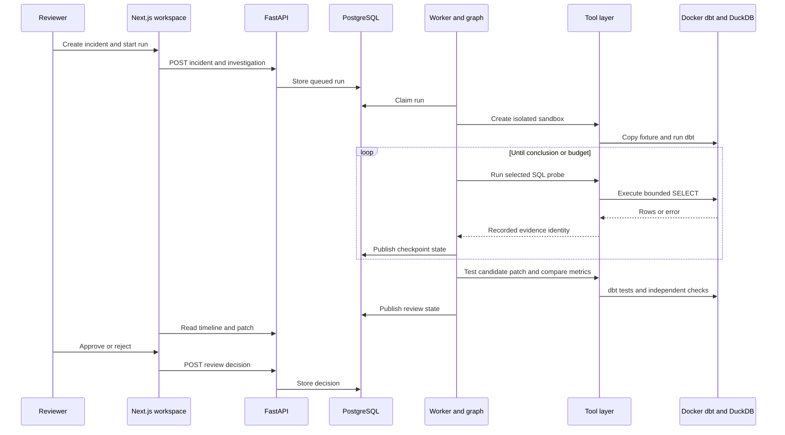

# Architecture

The local app separates review state from warehouse execution. The UI calls FastAPI, PostgreSQL holds incidents and worker claims, and the investigator stores graph checkpoints. The worker invokes typed tools; only the tool layer can touch the copied dbt project.

## Isolation and evidence

The sandbox copies an allowlisted source project; ground truth remains outside it. The investigator receives opaque sandbox IDs. File reads and patches pass path validation, and patches target existing `models/**/*.sql` files. Jinja accepts plain SQL with literal `ref()` and `source()` calls. SQL execution accepts a single bounded `SELECT`; DuckDB external access is disabled. Docker uses a loopback-independent process with no network, a read-only project mount, reduced capabilities, and resource limits. A timeout kills the named container.

The tool layer records the run ID, sandbox ID, exact SQL, probe name, rows, and error for each query. The graph gate requires evidence links to those records and a genuinely tested competing probe. It checks dbt tests and metric reconciliation before exposing a patch for review. A row-level comparison covers unrelated models. The scorer reads hidden ground truth only after the graph finishes.

## State handling

PostgreSQL stores the queue, incidents, and review lifecycle. Workers claim available runs with row locks. LangGraph persists checkpoints in SQLite so a step can resume after a worker interruption. Cancellation takes effect at a checkpoint boundary. The API returns status and trace events to the UI, which polls while a run is active. Approval stores a decision and does not change the source dbt template.

The API has no authentication. The guard is a research boundary; time-of-check/time-of-use and trust in the host process are not closed. See [Security](../SECURITY.md) and [Reference](REFERENCE.md).
